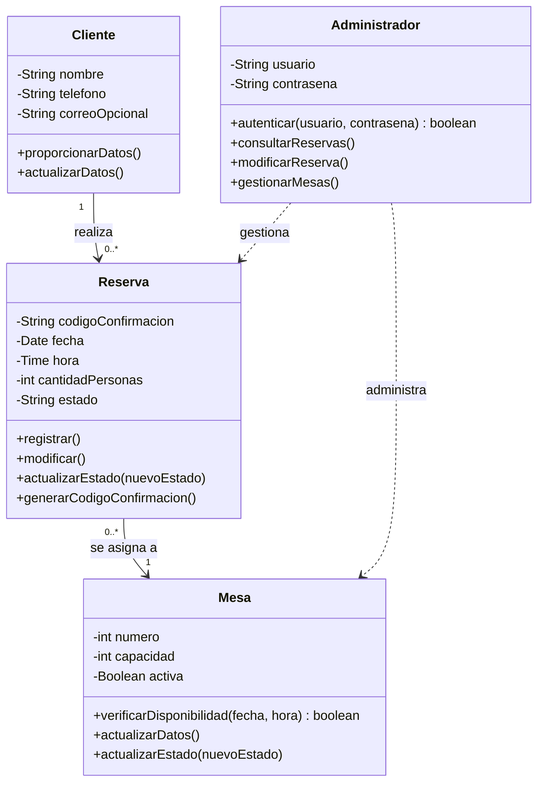

# Diagrama de clases del dominio

Este diagrama representa el diseño conceptual de MesaFácil.

La clase `Administrador` representa al usuario administrativo proporcionado
por Django Authentication y Django Admin. No corresponde a un modelo propio
del dominio.

